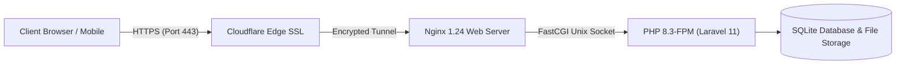

# SIAKAD & E-Learning SMP Negeri 2 Subang
**Tugas Proyek: Pengembangan & Pengamanan Aplikasi Web**  
*Mata Kuliah: Cyber Security — Semester 5*

---

## 📌 Ringkasan Proyek

| Informasi | Keterangan |
| :--- | :--- |
| **Nama Aplikasi** | Sistem Informasi Akademik (SIAKAD) & E-Learning SMP Negeri 2 Subang |
| **Instansi / Sekolah** | SMP Negeri 2 Subang (Kec. Subang, Kab. Kuningan, Jawa Barat - NPSN: 20212952) |
| **URL Aplikasi Aktif (HTTPS)** | [https://fraction-capability-attempting-alarm.trycloudflare.com](https://fraction-capability-attempting-alarm.trycloudflare.com) |
| **URL Repository GitHub** | [https://github.com/twelight03/Siakad-dan-E-Learning-SMPN-2-Subang](https://github.com/twelight03/Siakad-dan-E-Learning-SMPN-2-Subang) |
| **Status Pengujian** | ✅ **176 Passed (515 Assertions)** — Termasuk 12 Security Hardening Suite |

---

## 🔑 Akun Uji Coba (Demo Credentials)

Untuk keperluan pengujian fitur dan penilaian oleh dosen/evaluator, gunakan akun berikut:

> **Password untuk semua akun:** `password`

| Role | Username | Email | Nama Pengguna | Hak Akses Utama |
| :--- | :--- | :--- | :--- | :--- |
| 👨‍💼 **Administrator** | `admin` | `admin@siakad.smpn2subang.sch.id` | Administrator SIAKAD | Akses penuh master data, user, jadwal, cetak laporan, & audit log |
| 👨‍🏫 **Guru** | `guru` | `budi@siakad.smpn2subang.sch.id` | Budi Santoso, S.Pd. | Presensi siswa, olah bobot/nilai, upload materi & penugasan |
| 👨‍🏫 **Guru Pendamping** | `guru_siti` | `siti@siakad.smpn2subang.sch.id` | Siti Rahma, M.Pd. | Akun guru pendamping mata pelajaran |
| 👨‍🎓 **Siswa** | `siswa` | `ahmad@siakad.smpn2subang.sch.id` | Ahmad Fauzan (NIS: 202607001) | Jadwal pelajaran, rekap presensi, nilai rapor, kumpul tugas |
| 👨‍🎓 **Siswa Lain** | `siswa_dewi` | `dewi@siakad.smpn2subang.sch.id` | Dewi Lestari (NIS: 202607002) | Akun pembanding uji coba isolasi data siswa (anti-IDOR) |

> 💡 **Registrasi Mandiri Siswa Baru:** Tersedia halaman registrasi mandiri di menu `Daftar Siswa` (`/register`) untuk mendaftarkan akun siswa baru dengan validasi data dan enkripsi password otomatis.

---

## 🚀 Fitur Utama Aplikasi

### 1. Autentikasi & Registrasi
- **Multi-Role Login:** Otentikasi aman berbasis Username atau Email dengan pengalihan otomatis ke dashboard role masing-masing.
- **Registrasi Akun Siswa Mandiri (`/register`):** Formulir pendaftaran siswa baru dengan validasi nama lengkap, username unik, NIS unik, jenis kelamin, email unik, dan konfirmasi password min. 8 karakter.
- **Pemberian Akun Terkontrol:** Administrator memiliki kendali untuk menambah, menonaktifkan, atau mereset password akun guru dan siswa.

### 2. Portal Administrator (Tata Usaha)
- **Master Data Pengguna:** Manajemen akun Admin, Guru, dan Siswa beserta profil lengkap.
- **Master Data Akademik:** Pengelolaan Tahun Ajaran aktif, Data Kelas (Tingkat 7, 8, 9), dan Mata Pelajaran.
- **Plotting & Penjadwalan:** Alokasi guru pengampu kelas dan pembuatan jadwal KBM dengan **deteksi bentrok otomatis**, serta tampilan jadwal terstruktur per hari dengan pembatas visual warna-warni.
- **Kenaikan Kelas & Distribusi Siswa:**
  - *Kenaikan Langsung 1 Kelas Penuh:* Memindahkan seluruh siswa satu kelas asal ke kelas tujuan tingkat berikutnya secara massal.
  - *Distribusi & Acak Siswa:* Mengacak dan membagikan siswa dari beberapa kelas asal ke kelas-kelas tujuan dengan kuota per kelas dan **penyeimbangan gender otomatis** (komposisi L/P sama rata).
- **Laporan & Rekapitulasi:**
  - Laporan Rekapitulasi Data Siswa per Kelas.
  - Laporan Rekapitulasi Presensi Kehadiran Siswa.
  - Laporan Rekapitulasi Nilai & Leger Nilai Siswa.
  - Laporan Rangkuman Penugasan & E-Learning.
  - Mode cetak ramah cetak (*Print/PDF ready*) dengan Kop Resmi Sekolah.
- **Audit Log Aktivitas:** Pencatatan setiap aksi penting pengguna (login, perubahan nilai, penghapusan data) untuk kebutuhan audit forensik.

### 3. Portal Guru
- **Presensi Digital Kelas:** Input presensi harian per pertemuan (Hadir, Sakit, Izin, Alpa) dengan ringkasan otomatis.
- **Komponen & Bobot Nilai Dinamis:** Penentuan bobot penilaian (Tugas, UTS, UAS) dengan validasi total bobot maksimal 100%.
- **Olah Nilai Siswa:** Pengisian dan rekapitulasi nilai akhir dengan validasi batas skor 0–100.
- **E-Learning & Bahan Ajar:** Upload materi pembelajaran digital dan pembuatan tugas terstruktur lengkap dengan tenggat waktu (*deadline*).
- **Generator Acak Kelompok Belajar:** Membagi siswa di kelas pengampu secara acak dan seimbang gender, dilengkapi fitur acak ulang, salin teks ke format WhatsApp, dan cetak PDF.
- **Pemeriksaan Tugas:** Melihat berkas kiriman siswa, memberikan umpan balik, dan input nilai tugas.

### 4. Portal Siswa
- **Jadwal Pelajaran Terpadu:** Menampilkan jadwal KBM aktif hari ini dan sepekan penuh.
- **Monitoring Kehadiran:** Rekap kehadiran mandiri secara transparan.
- **Transkrip & Rapor Nilai:** Melihat nilai harian, nilai ujian, serta nilai akhir secara berkala.
- **E-Learning Siswa:** Mengunduh materi pembelajaran yang diunggah guru serta mengunggah tugas (*file submission*).

---

## 🛠️ Arsitektur & Teknologi



- **Backend Framework:** Laravel 11.x (PHP 8.3 FPM)
- **Frontend / Styling:** Tailwind CSS 3.x, Alpine.js, Blade Templating Engine
- **Build Tool:** Vite 7.x
- **Database Engine:** SQLite 3 (ACID-compliant, zero network overhead)
- **Web Server:** Nginx 1.24 (Reverse Proxy & HTTP/2)
- **Operating System Server:** Ubuntu 24.04 LTS (VPS Cloud)
- **Deployment & SSL:** Cloudflare Zero Trust Tunnel (Valid End-to-End SSL/TLS, FQDN Publik)

---

## 🔒 Penerapan Aspek Keamanan Siber (Cyber Security)

Aplikasi ini dirancang mengikuti pedoman **OWASP Top 10** dan prinsip **Defense-in-Depth**:

| Komponen Keamanan | Implementasi pada Aplikasi |
| :--- | :--- |
| **Password Hashing** | Menggunakan algoritma **Bcrypt** dengan *work factor* adaptif dan *salt* unik otomatis. Password plaintext tidak pernah disimpan di database. |
| **Pencegahan SQL Injection** | Seluruh operasi basis data menggunakan Eloquent ORM dan PDO *Prepared Statements with Parameter Binding*. Payload SQLi `' OR 1=1 --` otomatis di-neutralize. |
| **Pencegahan XSS** | Seluruh data output di-render melalui Blade *automatic HTML entity escaping* (`{{ }}` / `htmlspecialchars`). Tag berbahaya `<script>` diubah menjadi entitas aman. |
| **Role-Based Access Control (RBAC)** | Pemisahan hak akses menggunakan middleware berlapis (`admin`, `teacher`, `student`). Upaya *privilege escalation* langsung diblokir dengan respon `403 Forbidden`. |
| **Pencegahan IDOR** | Akses terhadap data privat (seperti nilai siswa atau download berkas tugas) divalidasi berdasarkan *ownership policy*. Siswa A tidak dapat mengakses data siswa B dengan mengganti parameter URL ID. |
| **Rate Limiting & Anti-Brute Force** | Pembatasan percobaan autentikasi login (maksimal 5 percobaan gagal per menit per IP). Jika terlewati, sistem memberlakukan penguncian sementara (*HTTP 429 Too Many Requests*). |
| **CSRF Protection** | Seluruh form dengan method `POST`, `PUT`, `PATCH`, dan `DELETE` diproteksi token CSRF unik yang divalidasi middleware `VerifyCsrfToken`. |
| **Validasi & Sanitasi Upload File** | Pembatasan tipe file MIME type secara ketat (hanya dokumen `pdf, doc, docx, xls, xlsx, ppt, pptx, zip` dan gambar) dengan batas ukuran maksimal 10MB. File biner berbahaya (`.php`, `.exe`, `.sh`) ditolak keras. |
| **Manajemen Sesi yang Aman** | Cookie sesi dikonfigurasi dengan flag `HttpOnly` (anti-akses JavaScript), `Secure` (hanya lewat HTTPS), dan `SameSite=Lax`. Sesi lama langsung di-invalasi dan di-regenerasi saat proses login maupun logout. |
| **Security Response Headers** | Mengirimkan header keamanan HTTP: `X-Content-Type-Options: nosniff`, `X-Frame-Options: SAMEORIGIN` (anti-Clickjacking), `X-XSS-Protection: 1; mode=block`, dan `Referrer-Policy: strict-origin-when-cross-origin`. |
| **Proteksi Secret & File Sensitif** | Konfigurasi sensitif (kunci enkripsi `APP_KEY`, password database, kredensial VPS) disimpan murni di Environment Variable (`.env`). File `.env`, berkas database lokal, dan artefak sensitif di-ignore secara ketat dari repository Git. |
| **Enforced HTTPS (SSL/TLS)** | Menggunakan enkripsi TLS modern yang di-forward melalui Cloudflare Edge menuju backend server dengan paksaan skema HTTPS (`URL::forceScheme('https')`). |

---

## 🧪 Hasil Self-Testing Keamanan (12 Skenario Pengujian)

Pengujian dilakukan menggunakan automated test suite (`php artisan test`) dan verifikasi manual via `curl`:

| No | Skenario Pengujian | Metode Pengujian | Ekspektasi Keamanan | Hasil Uji | Keterangan / Mitigasi |
| :---: | :--- | :--- | :--- | :---: | :--- |
| **1** | Hashing Kata Sandi | Inspeksi field `users.password` di DB | Password tersimpan dalam hash `$2y$...` (Bcrypt) | **LOLOS** | Tidak ada plaintext tersimpan |
| **2** | SQL Injection pada Login | Input `' OR '1'='1` & `admin' --` pada form login | Login gagal, query tidak termanipulasi | **LOLOS** | Dilindungi Eloquent Prepared Statements |
| **3** | XSS Stored & Reflected | Input `<script>alert('XSS')</script>` pada nama & pengumuman | Script di-escape menjadi `&lt;script&gt;` | **LOLOS** | Blade auto-escaping aktif |
| **4** | RBAC Privilege Escalation | Siswa mengakses endpoint `/admin/users` atau `/teacher/grades` | Akses ditolak dengan status HTTP 403 / Redirect | **LOLOS** | Ditegakkan oleh RBAC Middleware |
| **5** | IDOR pada Rekap Nilai | Siswa A mengakses URL rekap nilai milik Siswa B via ID | Server menolak permintaan dengan status HTTP 403 | **LOLOS** | Ownership verification pada Controller |
| **6** | IDOR File Download | Pengguna mengunduh materi privat kelas lain via manipulasi URL | Unduhan ditolak (HTTP 403 Forbidden) | **LOLOS** | Policy cek enroll kelas aktif |
| **7** | Brute Force Login Attack | Mengirim 6 kali percobaan login dengan password salah | Percobaan ke-6 diblokir dengan HTTP 429 Rate Limit | **LOLOS** | Throttling aktif (maks 5 request/menit) |
| **8** | Proteksi CSRF | Request POST ke endpoint tanpa menyertakan `_token` | Permintaan ditolak dengan status HTTP 419 Page Expired | **LOLOS** | CSRF Middleware aktif |
| **9** | Upload File Berbahaya | Upload file `shell.php` atau file melebihi 10MB | Upload ditolak dengan pesan validasi tipe/ukuran | **LOLOS** | Validasi MIME & ukuran file aktif |
| **10** | Session Invalidation | Menggunakan token sesi lama setelah melakukan klik Logout | Sesi lama tidak berlaku, dialihkan ke halaman login | **LOLOS** | Session flushed & regenerated |
| **11** | HTTP Security Headers | Audit response header via `curl -I` | Header nosniff, sameorigin, xxss-protection terpasang | **LOLOS** | Middleware custom headers aktif |
| **12** | Secret Exposure Test | Pengecekan file `.env` dan DB file di git status / git log | Berkas rahasia ter-ignore oleh `.gitignore` | **LOLOS** | Secret tidak pernah ter-commit |

---

## 🤖 Keterbukaan Penggunaan AI Agent (AI Disclosure)

Sesuai ketentuan tugas proyek **Poin 3e**, penggunaan asisten AI dilaporkan secara transparan:

- **Alat AI yang Digunakan:** Google Antigravity (Google DeepMind Agentic AI Engine).
- **Bagian yang Dibantu:**
  1. *Perancangan Arsitektur Basis Data:* Normalisasi tabel akademik (relasi user, siswa, guru, kelas, mapel, jadwal, dan nilai).
  2. *Implementasi Keamanan Sistem:* Penyusunan 12 skenario pengujian unit & fitur (`SecurityTest.php`), konfigurasi header keamanan, dan hardening role middleware.
  3. *Optimasi Frontend & Responsivitas:* Penyesuaian layout Tailwind CSS agar mobile-friendly serta integrasi identitas resmi SMP Negeri 2 Subang.
  4. *Troubleshooting Deployment VPS:* Pembuatan konfigurasi Nginx reverse proxy dan integrasi Cloudflare Tunnel pada NAT VPS.
- **Contoh Prompt Utama yang Digunakan:**
  > *"Buatkan unit test di Laravel untuk menguji mitigasi OWASP Top 10: SQL Injection pada login, XSS escaping, IDOR pada modul nilai siswa, proteksi CSRF, dan brute-force rate limiting."*  
  > *"Bantu konfigurasi Nginx dan Cloudflare tunnel pada NAT VPS Ubuntu tanpa IP dedicated agar aset Vite di-load secara aman melalui HTTPS tanpa Mixed Content error."*
- **Metode Verifikasi Mahasiswa:**
  Mahasiswa meninjau baris demi baris kode yang dihasilkan, memastikan tidak ada celah keamanan atau kredensial rahasia yang terekspos, menjalankan seluruh test suite (`php artisan test`), dan memverifikasi fungsionalitas secara manual langsung di peramban web dan terminal VPS.

---

## 🎓 Potensi Pengembangan ke Skripsi (Tingkat 4)

Aplikasi ini dirancang dengan struktur fondasi yang modular sehingga sangat potensial untuk dilanjutkan menjadi penelitian Tugas Akhir / Skripsi pada program studi Teknik Informatika / Keamanan Siber dengan topik usulan:

> **"Rancang Bangun Sistem Informasi Akademik dan E-Learning Terintegrasi Menggunakan Pendekatan Zero Trust Architecture dan Multi-Factor Authentication (MFA) Berbasis Time-Based One-Time Password (TOTP)"**

### Rumusan Masalah yang Dapat Diangkat:
1. Bagaimana mengimplementasikan arsitektur *Zero Trust* pada sistem akademik sekolah menengah untuk mencegah ancaman pencurian identitas dan kebocoran nilai siswa?
2. Bagaimana efektivitas integrasi autentikasi dua faktor (2FA/TOTP) dalam menekan potensi kompromi kredensial akun pengajar dan administrator?
3. Bagaimana merancang skema *Digital Signature* berbasis kriptografi asimetris (RSA/ECDSA) untuk menjamin keaslian dan integritas dokumen rapor digital siswa?

### Rencana Fitur Lanjutan:
- **Two-Factor Authentication (2FA / Google Authenticator)** untuk akun Guru dan Admin.
- **Digital Certificate / QR Verification** pada cetak transkrip dan rapor nilai untuk mencegah pemalsuan dokumen akademik.
- **Role-Based Audit Logging dengan Elasticsearch / SIEM** untuk monitoring aktivitas mencurigakan secara *real-time*.

---

## 💻 Panduan Instalasi Lokal (Local Development)

Jika ingin menjalankan proyek ini di lingkungan lokal (laptop/komputer):

### 1. Prasyarat
- PHP >= 8.2 (dengan ekstensi `pdo_sqlite`, `mbstring`, `openssl`, `tokenizer`, `xml`, `ctype`, `curl`)
- Composer >= 2.x
- Node.js >= 18.x & NPM

### 2. Kloning Repository
```bash
git clone https://github.com/twelight03/Siakad-dan-E-Learning-SMPN-2-Subang.git
cd Siakad-dan-E-Learning-SMPN-2-Subang
```

### 3. Instalasi Dependensi
```bash
composer install
npm install
```

### 4. Konfigurasi Environment File
Salin template konfigurasi `.env.example`:
```bash
cp .env.example .env
php artisan key:generate
```

Isi konfigurasi minimal pada `.env`:
```ini
APP_NAME="SIAKAD SMPN 2 Subang"
APP_ENV=local
APP_DEBUG=true
APP_URL=http://localhost:8000

DB_CONNECTION=sqlite
# Database SQLite otomatis dibuat pada database/database.sqlite
```

### 5. Migrasi dan Seeding Data Uji Coba
```bash
php artisan migrate:fresh --seed
```

### 6. Build Aset Frontend
```bash
npm run build
```

### 7. Menjalankan Server Lokal & Pengujian
```bash
# Menjalankan server aplikasi
php artisan serve

# Menjalankan seluruh pengujian otomatis
php artisan test
```
Buka browser di `http://localhost:8000` dan login menggunakan salah satu akun demo.

---

## 📄 Lisensi & Hak Cipta
Dikembangkan untuk keperluan akademik Mata Kuliah **Cyber Security** (Semester 5).  
Hak cipta © 2026 SMP Negeri 2 Subang & Pengembang.
